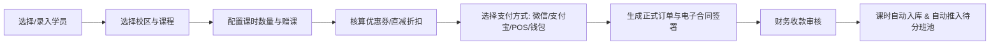

# 拓视未来教育「一校教培系统」核心模块架构与复刻设计规范

> 本文档基于对拓视未来教育「一校教培系统」（证券代码：002599）生产环境运行态、真实浏览器渲染 DOM、微前端编译包（Webpack AST / Vue-Router）以及 LocalStorage 全局权限树的深度逆向解析整理而成。旨在为后续**100% 像素级复刻前端 UI 样式**与**完整实现业务功能逻辑**提供完备的技术方案与设计蓝图。

---

## 目录
1. [全局设计系统与布局规范 (Design System)](#一全局设计系统与布局规范-design-system)
2. [教研模块 (Curriculum) 深度解析](#二教研模块-curriculum-深度解析)
3. [学员模块 (StudentCenter) 深度解析](#三学员模块-studentcenter-深度解析)
4. [教务模块 (Educational) 深度解析](#四教务模块-educational-深度解析)
5. [财务模块 (Financial) 深度解析](#五财务模块-financial-深度解析)
6. [系统模块 (SystemSetting) 深度解析](#六系统模块-systemsetting-深度解析)
7. [技术栈选型与复刻实施建议](#七技术栈选型与复刻实施建议)

---

## 一、全局设计系统与布局规范 (Design System)

系统整体采用现代化教育 SaaS 管理系统设计，以**盛通蓝**为基调，视觉上追求清晰、高信息密度与严谨的流程反馈。

### 1.1 色彩系统 (Color Palette)

| 颜色类别 | 色值 (HEX) | 使用场景 |
| :--- | :--- | :--- |
| **品牌主色 (Primary)** | `#1890FF` | 顶栏活跃指示点、主按钮、激活Tab、链接文字、复选框激活色 |
| **辅助功能色 (Success)** | `#52C41A` / `#67C23A` | 已上日程、操作成功标签、审核通过、启用状态开关 |
| **警示告警色 (Warning)** | `#FAAD14` / `#E6A23C` | 待办审核红点、审核中状态、预警通知、充值入口 |
| **危险错误色 (Danger)** | `#FF4D4F` / `#F56C6C` | 冲突日程、退费金额、订单驳回、删除操作、必填项星号 `*` |
| **次要重点色 (Purple)** | `#722ED1` | 排课专属高频图标、我的日程标识 |
| **价格与强调色** | `#FF4D4F` / `#F5222D` | 课程单价（如 `300元/次`）、实收统计金额 |
| **背景灰色阶** | `#F5F7FA` | 页面全局大背景、表格表头背景、禁用态输入框背景 |
| **卡片与容器底色** | `#FFFFFF` | 主工作区、表格卡片、侧边栏底色 |
| **文字主色 (Title)** | `#1F2D3D` / `#303133` | 一级标题、表格正文字体、卡片标题 |
| **文字次色 (Regular)** | `#5E6D82` / `#606266` | 筛选表单标签、副标题、说明文本 |
| **弱化文字 (Secondary)**| `#909399` / `#C0C4CC` | 输入框占位符、未选Tab文本、小计提示语 |
| **边框分隔线** | `#EBEEF5` / `#E4E7ED` | 单元格分割线、卡片投影与外边框 |

---

### 1.2 页面栅格与骨架布局 (Layout Anatomy)

```
+-------------------------------------------------------------------------------------------------------+
| [Logo] 一校 教培系统 (002599)  | CRM | 教研 | 学员 | 教务 | 运营 | 店铺 | 赛考 | 进销存 | 财务 | 系统 | [Ai] [🔔9] [⬇] [用户头像] | 60px (Header)
+-------------------------------------------------------------------------------------------------------+
| [左侧边栏 Sidebar] (220px) | [主工作区 Main Workspace] (calc(100% - 220px))                          |
|  - 模块一级菜单组 (折叠/展开)  |   - 面包屑导航 (Breadcrumb) 如: 财务 / 订单管理                          |
|  - 二级页面路由菜单           |   - 状态/类型分段 Tab (Segmented Tabs) 如: 已支付 | 未支付 | 已驳回       |
|  - 选中高亮 (浅蓝背景+粗体字)   |   - 高级筛选面板 (Filter Form Card): 4列~8列网格自适应                    |
|                            |   - 操作统计横条 (Summary Bar): "当前条件下：共计7笔缴费，实缴14000.00元" |
|                            |   - 核心数据表格 (Data Table) / 卡片流 (Card Grid) / 日历甘特图 (Calendar) |
|                            |   - 底部工具条: [批量操作] + [分页器 Pagination]                        |
| [校区切换浮标: 总部校区]     |                                                                       |
+-------------------------------------------------------------------------------------------------------+
```

* **Header (顶栏 - 60px)**：全局置顶，白底加底部柔和阴影，中间为主微前端子系统切换，右侧包含消息小红点与多校区切换浮标。
* **Sidebar (侧边栏 - 220px)**：支持单级菜单与两级折叠菜单，可点击收缩为 64px 纯图标模式。
* **Breadcrumb (面包屑)**：字体大小 14px，灰色层级指示。
* **Filter Area (筛选区)**：支持折叠展开，网格间距 12px~16px，表单项紧凑型（高度 32px~36px）。
* **Table (数据表格)**：表头高 44px（灰色底 `#FAFAFA`），行高 50px~56px，鼠标 hover 高亮背景色 `#F5F7FA`，右侧操作列固定（Fixed Right）。

---

### 1.3 权限与元数据模型 (RBAC Model)

系统底层严格遵循树状权限模型：
* `functionType = 1`：**页面与菜单项**（对应 Vue-Router 路由节点及侧边栏 Menu Item）。
* `functionType = 2`：**页面操作按钮权限**（如 `新增`、`导出`、`修改订单`、`作废`、`审核通过`），前端配合 `v-permission="xxx:xxx"` 自定义指令进行 DOM 级显隐控制。

---

## 二、教研模块 (Curriculum) 深度解析

教研模块是整个教培机构的“核心资产库”，主要承载机构标准化课程体系、课程单价规则、教案课件及编程代码素材的管理。


### 2.1 路由结构与功能树

```
教研 (curriculum)
├── 课程管理 (/curriculum/courseManage) [courseManage]
│   ├── [操作按钮]: 批量操作、批量授权、新增课程、按校区/机构授权、复用课程、删除、启用/禁用、高级搜索
│   ├── 新增课程 (/curriculum/additionalCourse) [additionalCourse]
│   └── 编辑课程 (/curriculum/editorCourse) [editorCourse]
│       ├── 基本信息 (/curriculum/editCourse/basicInfo) [courseBasicInfotraining]
│       │   └── [按钮]: 保存、设置所属年级/期段/科目
│       ├── 课程授权 (/curriculum/editCourse/authorization) [courseAuthorizationtraining]
│       │   ├── 按校区授权 (/curriculum/editCourse/byCampus) [byCampustraining]
│       │   └── 按机构授权 (/curriculum/editCourse/byCompany) [byCompanytraining]
│       └── 上课进度 (/curriculum/editCourse/progress) [courseProgresstraining]
│           └── [按钮]: 新增单元、单元/课次排序、保存顺序、白板互动课件编辑
└── 编程素材 (/curriculum/publicMaterial) [publicMaterial]
    └── [按钮]: 新增分组、删除分组、编辑素材、新增素材、素材类型过滤(Python/C++/Scratch)
```

### 2.2 核心页面 UI 与交互规范

#### 1. 课程管理页（卡片流网格 Card Grid 模式）
* **顶部胶囊筛选栏 (Tag Filter)**：
  * **适用年级**：全部、初级课程、中级课程、高级课程、幼儿园、小学低、小学高、中学。
  * **课程属性**：全部、常规课程、扩科课程、活动课程、体验课程、教师培训、服务费、宣传素材。
  * **课程状态**：全部、启用、禁用。
  * **下拉复合筛选**：科目、课程类型、年份、期段、课程名称模糊匹配。
* **卡片矩阵 (Card Item Layout)**：
  * 卡片尺寸：自适应宽度（最小 240px，1行6列~1行4列响应式）。
  * 顶部封面图（16:9），左上角附带微立体角标（如黄色 `#E6A23C`“扩科课程”；绿色“教师培训”）。
  * 课程标题：16px 粗体，支持两行省略。
  * 课程标签集：`[授权]`（橙色线框）、`[扩科-实践-总部-软编]`（浅蓝细框）。
  * 价格显示：右下角红色加大粗体（如 `300元/次`、`1000元/次`）。
  * 底部状态条：左侧内嵌 Element 风格的 Switch 滑块开关，显示“启用中/已禁用”。

#### 2. 课程编辑页（三段式分步表单）
* **Tab 1 基本信息**：课程大类、对应科目、标准课时时长（45min/60min/90min）、满班人数上限、适用年龄段。
* **Tab 2 课程授权**：采用树状 Transfer 穿梭框，左侧为全部校区/加盟机构树，右侧为已授权范围，支持批量覆盖与撤销。
* **Tab 3 上课进度树**：
  * 支持建立“单元 (Unit) -> 课次 (Lesson)”的二级树状目录。
  * 支持拖拽重新排序（Drag & Drop Sort）。
  * 课次关联教学课件（PPT、B站/百家云直播录播视频、白板教案、互动习题代码）。

---

## 三、学员模块 (StudentCenter) 深度解析

学员模块是教培业务的 CRM 与核心主体，覆盖学员“档案建档 -> 报名付费 -> 分班入班 -> 课消互动 -> 学情档案 -> 异动离校”全生命周期。


### 3.1 路由结构与功能树

```
学员中心 (studentCenter)
├── 学员管理 (/studentCenter/sudentRegulate) [sudentRegulate]
│   ├── 全部学员 (/studentCenter/allStudent) [allStudent]
│   │   └── [按钮]: 新增学员、批量导出课包、批量导入、人脸识别底库录入、编辑、家校绑定、异动申请、缴费导出
│   ├── 待分班学员 (/studentCenter/awaitDivideClass) [awaitDivideClass]
│   │   └── [按钮]: 查看测评报告、加入班级、批量导出
│   ├── 代报考管理 (/studentCenter/registerBehalf) [registerBehalf]
│   │   ├── 学员报考信息 (/studentCenter/registrationInfo) [registrationInfo]
│   │   ├── 代报考核销 (/studentCenter/verification) [verification] (易快报对接)
│   │   └── 服务费批量核销 (/studentCenter/batchVerification) [batchVerification]
│   └── 学员详情 (/studentCenter/studentDetails) [studentDetails] (360°全景档案)
│       ├── 基本信息 (/studentCenter/basicInfo) [basicInfo] (修改密码/家校绑定/电话)
│       ├── 学员课程 (/studentCenter/signUpRecord) [signUpRecord] (课包列表/清空课包/续费)
│       ├── 学习档案 (/studentCenter/studentRecord) [studentRecord] (出勤历史/课堂评价/作业作品)
│       ├── 钱包明细 (/studentCenter/walletBalance) [walletBalance] (余额变动/提现/调整)
│       ├── 沟通记录 (/studentCenter/communicationRecord) [communicationRecord] (一键呼叫/跟进记录)
│       ├── 零花钱 (/studentCenter/goldDetails) [goldDetails] (积分奖励/商城兑换)
│       └── 赛事记录 (/studentCenter/matchRecord) [matchRecord] (考级与白名单赛事报送)
├── 学员报名 (/studentCenter/studentEnroll) [studentEnroll]
│   ├── 选择学员 (/studentCenter/studentSchoose) [studentSchoose]
│   ├── 报名详情 (/studentCenter/studentEnterFor) [studentEnterFor]
│   └── 订单详情 (/studentCenter/orderDetails) [orderDetails]
├── 电子钱包 (/studentCenter/electronicPurse) [electronicPurse]
│   ├── 充值 (/studentCenter/topUp) [topUp]
│   ├── 电子钱包管理 [electronicPurseMange] (消费/提现/充值/剩余明细导出)
│   └── 钱包充值记录 [rechargeRecord]
├── 学员异动 (/studentCenter/studentAbnormal) [studentAbnormal]
│   ├── 异动申请 (/studentCenter/moveToapply) [moveToapply] (转班/转校/换课/停课/退款)
│   └── 异动记录列表 (转让/换课/停课/退费/转校流水核查)
└── 学员导入 (/studentCenter/studentsImport) [studentsImport]
    ├── 学员信息导入 (/studentCenter/studentsMsgImport) [studentsMsgImport]
    └── 剩余费用导入 (/studentCenter/studentsCostImport) [studentsCostImport]
```

### 3.2 核心业务逻辑与流程复刻要点

#### 1. 学员 360° 全景画像设计
* **基本信息头部**：左侧圆形头像（支持摄像头拍照或上传，关联人脸考勤底库），旁边展示学员姓名、学号（如 `S948918`）、手机号、归属校区、在读状态标签、绑定家长微信号。
* **多维数据 Tab 组**：
  * **学员课程卡片**：列出学员名下所有课包，每个卡片展示【课程名、总课时、已消耗课时、剩余课时、到期时间、合同订单编号、状态：在读/已结课】。
  * **学习轨迹与成长档案**：时间轴形式串联历次上课出勤、讲师评语、课堂作品截图、随堂测验成绩。
  * **沟通日志**：支持对接软电话（TQSIP / 容联云），显示录音播放插件与回访文本。

#### 2. 学员报名签约标准流


#### 3. 复杂异动状态机
学员异动包含 **7 种典型分支**：
1. **转班 (Change Class)**：课时等额移转，自动解除原班级关联，进入新班级排课。
2. **换课 (Change Course)**：按剩余学费净值折算新课程课时，多退少补并生成差额订单。
3. **停课 (Suspend)**：冻结课程到期日，暂停排课，状态标记为“停课”。
4. **复课 (Resume)**：解冻课包，顺延有效期，重新分配入班。
5. **转校 (Transfer Campus)**：跨校区跨法人核算，需两方校区及总部财务协同审批。
6. **转让 (Transfer Student)**：将名下课时与钱包移交给直系亲属或新学员。
7. **退费 (Refund)**：核算已消耗课时金额、教材扣费及违约金，提交流水由财务原路或钱包退还。

---

## 四、教务模块 (Educational) 深度解析

教务模块是教培机构日常运营的心脏，核心解决**资源冲突检测**（教室、教师、时段）、**排课甘特调度**、**上课考勤签到**、**课消核算**及**家校课评**。


### 4.1 路由结构与功能树

```
教务 (educational)
├── 教学服务 (/educational/teachingService) [teachingService]
│   └── 讲台/授课工作台 (/educational/workbench) [workbench] (上课点名/课件白板/互动投屏/下课结算)
├── 班级课次 (/educational/classShift) [classShift]
│   ├── 排课日历 (/educational/crouseCalendar) [crouseCalendar]
│   │   ├── 上课日历 (/educational/attendClassCalendar) [attendClassCalendar]
│   │   ├── 课表汇总 (/educational/calendarCollect) [calendarCollect]
│   │   ├── 时间课表 (/educational/timeClassSchedule) [timeClassSchedule]
│   │   ├── 教室课表 (/educational/classroomCalendar) [classroomCalendar]
│   │   ├── 讲师课表 (/educational/teacherCalendar) [teacherCalendar]
│   │   ├── 班级课表 (/educational/classCalendar) [classCalendar]
│   │   └── 冲突记录 (/educational/conflictRecord) [conflictRecord]
│   │       ├── 学员冲突 (/educational/conflictRecord/studentClash) [studentClash]
│   │       ├── 讲师冲突 (/educational/conflictRecord/teacherClash) [teacherClash]
│   │       └── 教室冲突 (/educational/conflictRecord/classroomClash) [classroomClash]
│   ├── 班级管理 (/educational/classManagement) [classManagement]
│   │   ├── 班级详情 (/curriculum/classDetails) [classDetails] (批量排课/调班/结班/导入学员)
│   │   ├── 新增班级 (/curriculum/appendClass) [appendClass]
│   │   └── 编辑班级 (/curriculum/editClass) [editClass]
│   ├── 课次管理 (/educational/classTimeManagement) [classTimeManagement] (课次状态调整/明细导出)
│   ├── 补课管理 (/educational/makeLessonManagement) [makeLessonManagement] (插班补课/1v1补课/直接课耗)
│   └── 试听管理 (/educational/auditionManagement) [auditionManagement] (试听排班/邀约转化)
├── 课消课评 (/educational/eliminationEvaluation) [eliminationEvaluation]
│   ├── 课消记录 (/educational/classSalesRecord) [classSalesRecord] (重新签到/反结课)
│   ├── 课消审核 (/educational/classSalesCheck) [classSalesCheck] (批量审核课消真实性)
│   ├── 课评管理 (/educational/evaluateRecord) [evaluateRecord] (阶段课评/一键生成/AI课评/微信推送)
│   └── 学员清理记录 (/educational/emptyRecords) [emptyRecords] (课包清零流水)
└── 售卖课程 (/educational/sellingCourse) [sellingCourse] (绑定课包与售价)
```

### 4.2 核心组件复刻规范：动态时间矩阵课表 (Time Matrix Grid)

时间课表（如 `educational_timeSchedule.png` 所示）是教务系统的技术复杂度最高点：

* **时间轴网格 (Time Matrix)**：
  * **Y 轴 (Time Axis)**：`07:00 ~ 22:00`，每行代表 1 小时（行高 60px），内部以虚线均分为半小时刻度。
  * **X 轴 (Date Axis)**：周一至周日共 7 列（附带当前日期与星期，如 `9/21 周一`）。
* **课程卡片块 (Schedule Chips)**：
  * 绝对定位渲染：根据 `top = (startTime - 7:00) * 60px`，`height = (duration / 60) * 60px` 动态绘制。
  * 颜色语义映射：
    * `已上日程`：绿色卡片背景（`#F0F9EB`，边框 `#67C23A`）。
    * `冲突日程`：红色警示背景（`#FEF0F0`，边框 `#F56C6C`）。
    * `我的日程`：紫色高亮背景（`#F9F0FF`，边框 `#722ED1`）。
    * `其他日程`：浅蓝标准背景（`#ECF5FF`，边框 `#409EFF`）。
  * 内部文本结构：
    * 状态胶囊角标：`[正]`（正式课）、`[补]`（补课班）、`[试]`（试听课）。
    * 课程/班级名称：如 `2班-单片机周六2:30`。
    * 教师名与教室：如 `乐博教室1 / 张老师`。
* **冲突检测引擎算法 (Collision Detection)**：
  * 在拖拽或新建课次时，同时校验三个约束：
    1. **讲师排班冲突**：同一讲师在同一时间段是否存在重叠课次。
    2. **教室占用冲突**：同一物理教室在同一时段是否存在重叠排课。
    3. **学员时间冲突**：同一学员是否同时被排入两门重叠的课程中。

---

## 五、财务模块 (Financial) 深度解析

财务模块统筹全校区的资金进出风控，包含**线上/线下全渠道订单核算**、**预收款资金池**、**各类业务审批流**及**发票税务开具**。


### 5.1 路由结构与功能树

```
财务中心 (financial)
├── 订单管理 (/financial/orderManagement) [orderManagement]
│   ├── [分段Tab]: 常规收费 | 季度收费
│   ├── [状态Tab]: 已支付列表 | 未支付列表 | 已驳回列表 | 订单作废列表
│   └── [功能操作]: 上传/修改凭证、继续充值、取消订单、修改订单、继续报名、订单导出
├── 学员审批 (/financial/studentApproval) [studentApproval]
│   ├── 收款审批 (/financial/proceedsCheck) [proceedsCheck]
│   │   ├── 普通常规收款审批 (/financial/collectExamine) [collectExamine] (批量通过/驳回/反确认)
│   │   ├── 季度收款审批 (/financial/quarterlyPayment) [quarterlyPayment]
│   │   ├── 电子钱包预存审批 (/financial/walletPrestore) [walletPrestore]
│   │   └── 代报考审批 (/financial/registerBehalfApprove) [registerBehalfApprove]
│   ├── 异动审批 (/financial/transactionCheck) [transactionCheck]
│   │   ├── 学员转让审批 (/financial/makeOverExamine) [makeOverExamine]
│   │   ├── 学员换课审批 (/financial/changeClassExamine) [changeClassExamine]
│   │   ├── 学员停课审批 (/financial/suspendClassExamine) [suspendClassExamine]
│   │   ├── 退回电子钱包审批 (/financial/refundPurse) [refundPurse]
│   │   ├── 学员转校审批 (/financial/classTransferExamine) [classTransferExamine]
│   │   ├── 清理课包审批 (/financial/clearClassBagApproval) [clearClassBagApproval]
│   │   └── 清理钱包审批 (/financial/clearWalletApproval) [clearWalletApproval]
│   └── 退费审批 (/financial/refundApproval) [refundApproval]
│       ├── 学员退费审批 (/financial/moneyBackExamine) [moneyBackExamine]
│       └── 电子钱包提现审批 (/financial/withdrawDeposit) [withdrawDeposit]
└── 学员发票 (/financial/studentInvoice) [studentInvoice]
    ├── 发票申请 (/financial/invoiceApplication) [invoiceApplication] (批量提交/快递单号回填)
    └── 发票审核 (/financial/invoiceReview) [invoiceReview] (开票通过/驳回)
```

### 5.2 复杂订单管理 UI 与表格复刻规范

参考 `financial_order_management.png` 的真实渲染：

1. **多级条件网格表单 (Complex Filter Grid)**：
   * 采用 3 行紧凑型排版（每行 7~8 个控件），全部使用 `size="small"`（高度 32px）。
   * 包含复合搜索项：姓名/学号/手机号、提交人、业绩归属人、渠道来源、班级选择器（带弹窗多选）、课程类型、收费类型、订单状态、学员状态、异动状态、出库状态、日期范围选择器（默认当月 1 号至月末）。
2. **动态统计横条 (Summary Strip)**：
   * 紧贴筛选区下方，浅灰色文本：`当前条件下：共计 7 笔缴费，实缴金额 14000.00 元`。
   * 右侧放置操作按钮组：`[选择列]`（可动态勾选表格显隐列，保存在 LocalStorage 中）、`[导出]`（导出 Excel）。
3. **数据表格列定义 (Table Schema)**：
   * `selection`：多选框。
   * `studentName`：学员姓名（蓝色链接高亮，点击可呼出学员抽屉详情）。
   * `studentNo`：学号（如 `S948918`）。
   * `orderNo`：订单编号（支持一键复制）。
   * `phone`：脱敏手机号（如 `156****0125`）。
   * `signupTime`：报名时间（带排序）。
   * `payTime`：支付时间（精确到秒）。
   * `originalPrice`：订单原价。
   * `discountAmount`：直减金额。
   * `couponAmount`：优惠券抵扣。
   * `receivableAmount`：应交金额 / 实收金额。
   * `goodsDelivery`：商品出库状态（已出库/未出库）。
   * `operation` (固定右列)：修改订单、查看凭证、操作成功标签。

---

## 六、系统模块 (SystemSetting) 深度解析

系统模块是整个 SaaS 平台的底座中台，承担组织架构、员工账号、权限组授权、业务流程参数、外部硬件及第三方生态对接。


### 6.1 路由结构与功能树

```
系统管理 (systemSetting)
├── 机构管理 (/systemSetting/authoritiesInformation) [authoritiesInformation]
│   ├── 组织架构 (/systemSetting/organizationalStructure) [organizationalStructure] (机构/大区/校区/部门/岗位树)
│   ├── 员工管理 (/systemSetting/employeeManagement) [employeeManagement] (账号管理/重置密码/手机号)
│   ├── 权限组管理 (/systemSetting/permissionGroupManagement) [permissionGroupManagement] (功能权限/数据权限勾选)
│   └── 机构信息 (/systemSetting/authoritiesInformation) (机构编码/LOGO配置/转让管理员/到期时间)
├── 功能设置 (/systemSetting/functionManage) [functionManage]
│   ├── 招生运营设置 (/systemSetting/recruitStudent) [recruitStudent]
│   │   ├── 接量规则、回收规则、线索分类、跟进类型、公海原因、线索阶段、呼叫中心、渠道管理
│   ├── 教研中心配置 (/systemSetting/teachingCenter) [teachingCenter]
│   │   ├── 课程属性、年级、科目分类、班型、期段、题库试题类型/属性/等级、教学目标设置
│   ├── 教学教务设置 (/systemSetting/teachingEdu) [teachingEdu]
│   │   ├── 签到设置、自动签到、自动课耗、课评模板、缺席/请假/停课/退学/异常原因字典
│   │   ├── 异动原因字典配置 (换课/转让/停课/退费/转校原因)
│   │   ├── 教室设置、常用上课时长 (45/60/90min)、授课时段、节假日与调休设置
│   │   └── 学员预警规则阈值 (待入班/回访/课程过期/请假/剩余课次不足/学员沉睡活跃预警)
│   ├── 目标考核设置 (/systemSetting/assessmentTarget) [assessmentTarget]
│   │   ├── 预收目标、招生人头数、新招生预收、复购预收、课耗目标设定
│   └── 高级设置 (/systemSetting/advancedSetting) [advancedSetting] (审批流开启/关闭、业务流程强管控开关)
└── 服务设置 (/systemSetting/serveManage) [serveManage]
    ├── 支付设置 (/systemSetting/paySetting) [paySetting] (现金转账/POS机/微信支付宝线上扫码/线下扫码)
    ├── 电子合同 (/systemSetting/electronPact) [electronPact] (契约锁/法大大签约模板配置)
    ├── 刷脸考勤 (/systemSetting/onLineSignIn) [onLineSignIn] (点学App客户端下载/人脸活体识别/算法阈值)
    ├── 公众号绑定 (/systemSetting/officialAccounts) [officialAccounts] (微信模板消息推送绑定)
    ├── 素材资源库 (/systemSetting/resourceWarehouse) [resourceWarehouse] (图片/视频/音频/文档云盘管理)
    └── 财务与ERP对接 (用友 U8C 推送配置、易快报报销审批对接)
```

### 6.2 中台核心数据模型与复刻设计

#### 1. 机构租户与校区上下文 (Tenant & Campus Context)
系统在 Header 和 LocalStorage 中维护全局状态：
* `CompanyId`：当前所属法人机构 ID。
* `CampusId`：当前选中的物理校区 ID（如总部校区、分校区）。
* `campusIdList`：当前操作员被授权管辖的全部校区列表。
* **数据隔离机制**：除超级管理员外，所有业务接口请求头均附带 `CompanyId` 与 `CampusId`，后端 SQL 自动拼装校区隔离过滤条件。

#### 2. 细粒度权限配置器 (Permission Tree Matrix)
权限组管理支持**“系统 -> 模块 -> 页面 -> 按钮”**四级复选树：
* 勾选父节点自动半选，子节点全选联动。
* 区分**功能权限**（是否能看到按钮）与**数据权限**（全部校区数据、仅本校区数据、仅本部门数据、仅本人数据）。

---

## 七、技术栈选型与复刻实施建议

为在本地优雅、高性能地复刻拓视未来教育「一校教培系统」，建议采用如下前后端技术栈架构：

### 7.1 前端现代化复刻技术栈 (Modern Frontend Stack)

* **核心框架**：`Vue 3` (SFC + Composition API + `<script setup>`)
* **构建工具**：`Vite 5`（毫秒级热更新，替代原老旧 Webpack 4）
* **语言标准**：`TypeScript 5`（全套业务实体类型定义）
* **UI 组件库**：`Element Plus`（与原 Element UI 100% 视觉风格继承，无缝还原组件外观）
* **辅助样式**：`TailwindCSS`（快速调整微立体阴影、间距、Flex/Grid 栅格）
* **状态管理**：`Pinia`（替代 Vuex，管理用户 Token、当前校区、待办消息、权限菜单表）
* **图表引擎**：`ECharts 5`（精准复刻预收平滑波浪图、营收环形饼图、漏斗图）
* **富文本/课件白板**：`wangeditor` 或 `tiptap` + `Canvas/Fabric.js`（教学白板）

### 7.2 核心公用组件库规划 (Component Architecture)

```
src/components/
├── AppHeader/                # 全局顶栏 (Logo、主系统导航、消息通知、校区切换浮标)
├── AppSidebar/               # 左侧导航栏 (支持两级折叠与图标收缩)
├── FilterForm/               # 通用网格筛选表单 (自适应 4~8 列输入/下拉/日期)
├── DataTable/                # 增强型数据表格 (自适应高度、列选择显隐、分页联动、导出)
├── TimeMatrixSchedule/       # 教务专属: 7x15 动态时间课表甘特图组件
├── StudentAvatarUpload/      # 人脸识别头像采集与底库上传裁剪组件
├── ApprovalTimeline/         # 财务专属: 审批流进度时间轴组件
└── MetricCard/               # 数据大屏专属: 渐变面积图与指标卡片
```

---

## 附录：截图资源索引

本文档关联的完整真实高清截图均已归档至本项目 `docs/screenshots/` 目录下，供开发随时对照像素细节：

* 工作台总览: [`docs/screenshots/yixiao_dashboard_overview.png`](file:///Users/donghaichao/Desktop/new_xitong/docs/screenshots/yixiao_dashboard_overview.png)
* 教务教学服务: [`docs/screenshots/yixiao_tab_2.png`](file:///Users/donghaichao/Desktop/new_xitong/docs/screenshots/yixiao_tab_2.png)
* 销售跟进看板: [`docs/screenshots/yixiao_tab_4.png`](file:///Users/donghaichao/Desktop/new_xitong/docs/screenshots/yixiao_tab_4.png)
* 财务营收退费: [`docs/screenshots/yixiao_tab_finance.png`](file:///Users/donghaichao/Desktop/new_xitong/docs/screenshots/yixiao_tab_finance.png)
* 教研课程卡片网格: [`docs/screenshots/curriculum_courseManage.png`](file:///Users/donghaichao/Desktop/new_xitong/docs/screenshots/curriculum_courseManage.png)
* 学员档案与管理: [`docs/screenshots/student_allStudent.png`](file:///Users/donghaichao/Desktop/new_xitong/docs/screenshots/student_allStudent.png)
* 教务班级排课时间表: [`docs/screenshots/educational_timeSchedule.png`](file:///Users/donghaichao/Desktop/new_xitong/docs/screenshots/educational_timeSchedule.png)
* 财务订单流水与复杂筛选: [`docs/screenshots/financial_order_management.png`](file:///Users/donghaichao/Desktop/new_xitong/docs/screenshots/financial_order_management.png)
* 系统设置与组织机构: [`docs/screenshots/systemSetting_authoritiesInfo.png`](file:///Users/donghaichao/Desktop/new_xitong/docs/screenshots/systemSetting_authoritiesInfo.png)
