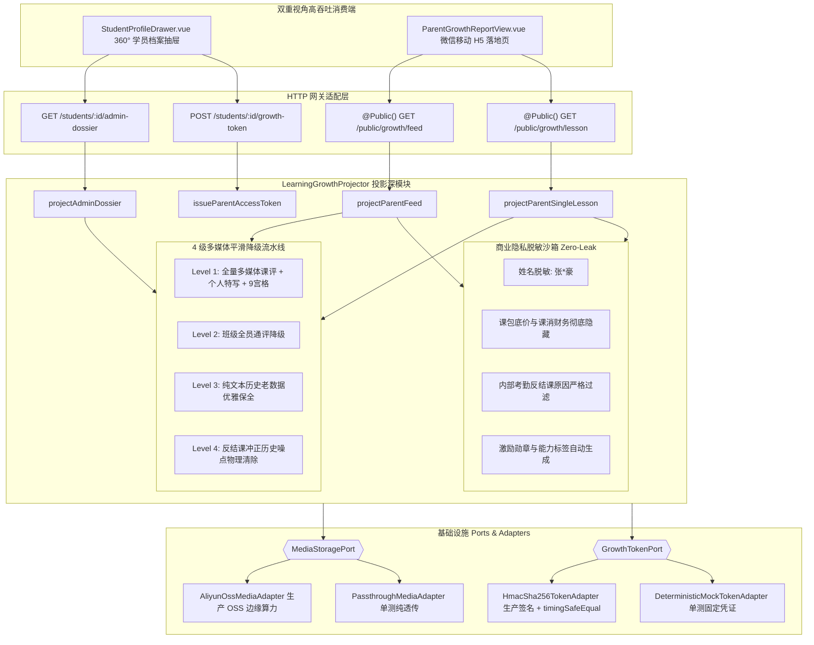

# ADR-0010: 学情成长投影深模块接入多媒体课评相册流 (LearningGrowthProjector)

## 状态
已通过 (Accepted)

## 上下文与问题陈述
在「一校教培系统」中，教学成果交付是连接授课教师、校区运营与学员家长的最核心价值链条。
此前系统虽然在 ADR-0005 与 ADR-0009 中打通了随堂点名消课、课评聚合根持久化与考勤双向渗透，但在学情成果展示与消费端存在以下痛点：
1. **多媒体孤岛与读取端胶水代码膨胀**：课评中包含的照片（9宫格相册）、随堂视频、教师语音点评、个性化特写标签等教学资产未深度折叠进学员学情档案；前端（`StudentProfileDrawer.vue`）需要多次请求接口并编写大量 JSON 反序列化、降级逻辑和图片处理胶水代码；
2. **多媒体资产处理成本与网络带宽损耗**：大图未在边缘做微缩裁剪（缩略图），多图加载造成首屏卡顿与不必要的 CDN 流量浪费；
3. **缺少专属微信家长端移动落地页**：以往课评通知家长端缺少一个免登录、但严格防越权（Anti-IDOR）、经过商业隐私脱敏（Zero-Leak）的移动 H5 落地页；
4. **历史老数据与冲正课次的呈现瑕疵**：老旧无课评的考勤记录极易发生前端渲染空指针（NPE），且反结课冲正的脏数据容易在家长端造成视觉困惑。

## 架构决策与接缝设计

经过候选方案对比，我们决定采用**以方案 C 的双重视角高吞吐工效接缝为外部界面，内部吸收方案 A 的 4 级多媒体平滑优雅降级与商业隐私脱敏沙箱，基础设施层建立方案 B 的 Ports & Adapters 双适配器架构**。

### 1. 外部接缝：双重视角高吞吐工效方法 (Dual-Perspective Ergonomics)
深模块为调用端提供 4 个高阶意图方法，彻底消除消费端的“二道贩子”胶水代码：
- `projectAdminDossier(studentId, options)`: 为后台 360° 学员档案抽屉直供富媒体时间轴、全景画廊 `albumGallery`（预排 9 宫格预览列表 `previewList`）、随堂原声波形采样序列、视频首帧封面及 SSOT 消课健康度；
- `projectParentFeed(token)`: 家长端免密全景瀑布流，物理出清反结课噪点，注入激励勋章与大纲重难点切片；
- `projectParentSingleLesson(token, scheduleEventId)`: 家长端单课特写落地页，高光呈现随堂照片、语音条、个性化评语与能力亮点；
- `issueParentAccessToken(studentId, scope, targetId, expiresInSeconds)`: 后台为家长一键签发安全令牌与开箱即用的落地页链接。

### 2. 内部实现：4 级多媒体平滑优雅降级
- **Level 1 (Full Multimedia)**: 完整解析 9 宫格相册，提取个人特写评语、能力标签与富媒体元数据；
- **Level 2 (Class-wide Fallback)**: 当无学员个人特写时，平滑回退至教师全班通评与班级共享照片；
- **Level 3 (Legacy Attendance Preservation)**: 面对历史老旧无课评考勤，安全输出空数组与原始考勤评语，杜绝 NPE 与空白降级；
- **Level 4 (Reversal Cleanse)**: 遵循冲正物理出清不变量，反结课课次在家长端 100% 物理消除，后台明确标识冲正原因与时间戳。

### 3. 基础设施层：Ports & Adapters 双适配器
- **`MediaStoragePort`**: 将图片微缩与视频封面截取算力下沉至阿里云 OSS 边缘管道（`x-oss-process`），后端仅做 URL 装饰，测试环境提供 `PassthroughMediaAdapter` 保证 0 外部网络 I/O；
- **`GrowthTokenPort`**: 采用标准 HMAC-SHA256 算法签发防篡改令牌，验证过程采用 Node.js `crypto.timingSafeEqual` 彻底杜绝时序攻击（Timing Attack），测试环境提供 `DeterministicMockTokenAdapter`。

## 架构收益与成效

1. **前端“零胶水代码 (Zero-glue Read Path)”**：`StudentProfileDrawer.vue` 代码精简度大幅提升，直接消费后端直供的 `photos`、`voiceMeta`、`videoMeta` 与 `albumGallery`；
2. **移动端家长免密触达闭环**：落地 `/public/growth-report` 极轻量免登录 H5，支持单课特写与全景成长轨迹双模，首屏秒开；
3. **绝对商业隐私防泄露 (Zero-Leak)**：姓名安全脱敏（如 `张*豪`），严格隐藏内部课包成本、正课扣费单价与反结课冲正历史；
4. **横向越权彻底阻断 (Anti-IDOR)**：单课令牌试图横向越权访问其他排课或学员时，硬性阻断 403 Forbidden；篡改密文阻断 401 Unauthorized。
5. **测试覆盖**：全套专属多媒体测试 `test-learning-growth-multimedia-projector.js`（48 项断言）、回归套件与全栈 E2E 100% 绿色通过。
